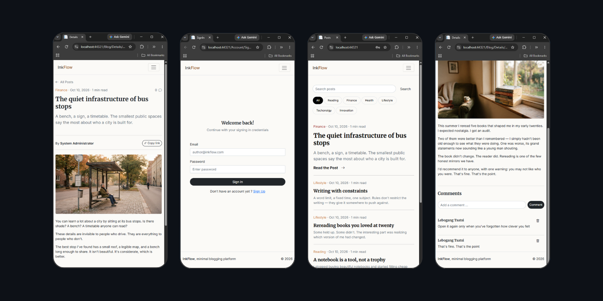

# InkFlow

>A FullStack Blogging System built with ASP.NET Core MVC,
>designed with a modern and user-friendly approach for readers
>and content creators.

Inkflow allows users to create, manage, and explore blog posts, organize content by category, and engage through comments, all within a centralized web application.

The project was built as a practical FullStack application to
demonstrate Authentication, Authorization, Onion Architecture,
Database Integration, Business Logic, CRUD operations,
and an User/Creators Dashboard.

https://inkflow-0752.onrender.com/

## Features

- User authentication & authorization
- Role-based access
- Post creation
- Post management
- Comments integration 

## Tech Stack

- C# and .NET
- JavaScript
- ASP.NET Core
- Entity Framework Core
- Supabase - PostgrestSql

## Architecture

The application uses a Onion architecture:

- `PresentationLayer` — MVC application
- `DomainLayer` — Domain models
- `RepositoryLayer` — Data access
- `ServiceLayer` — Business logic

**Contact:** ltsatsi18@gmail.com

## Author

**Lebogang Tsatsi**

Built as a FullStack portfolio project demonstrating ASP.NET Core, authentication, database integration, business logic application development.
